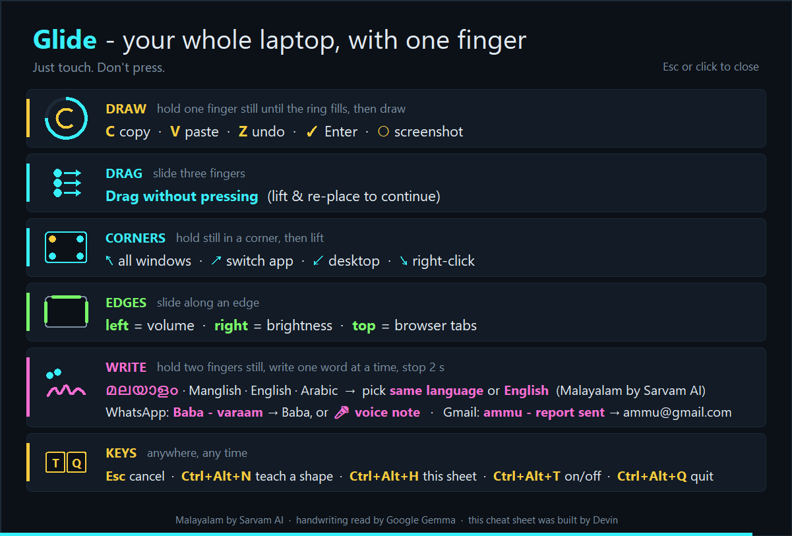
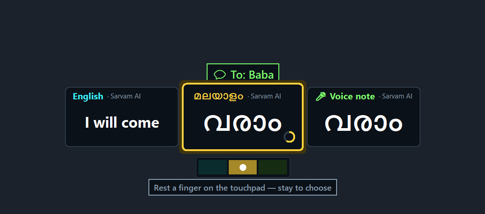
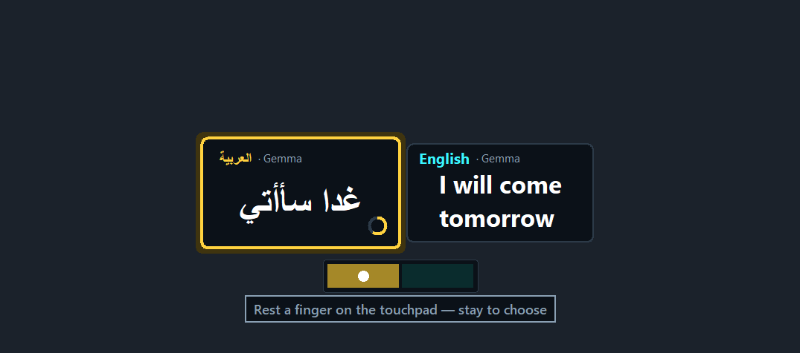

# Glide — your whole laptop, with one finger

> *Just touch. Don't press.*

**Put your left hand behind your back. Now copy a paragraph, switch to WhatsApp, and send it.**
You can't: Ctrl+C, Alt+Tab and Enter need two hands, and dragging needs you to press hard and
move at the same time. Laptops are designed for two healthy hands.

**Glide turns the touchpad you already have into a one-finger controller** — and lets you write
and send messages in **Malayalam, Manglish, English or Arabic** with the same finger.
No new hardware, nothing to install: one `.exe`.

Built overnight at **HackaThoni 2026** on a houseboat in Alappuzha ·
**Track 03 — Beyond the Screen** (gesture / sensor control) · **Track 02 — Beyond English** (Sarvam).



---

## Who it's for

- **Anyone with one hand in a cast** — a broken wrist doesn't pause exams, placements or work.
- **People with one usable hand** after a stroke, an amputation or a nerve injury.
- **People with tremors or weak grip**, for whom pressing-and-holding is hard. Glide *learns
  their own wobbly shapes* instead of demanding a perfect C.
- **Malayalam speakers** who find typing Malayalam on an English keyboard painful — they can
  write Manglish or Malayalam with a finger and send it as text or a voice note.

## What it does

| Do this on the touchpad | Get |
|---|---|
| Hold one finger still (a ring fills), then draw **C / V / Z / ✓ / ○** | Copy · Paste · Undo · Enter · Screenshot |
| Draw **your own shape** (taught 3× with Ctrl+Alt+N) | Open WhatsApp, Gmail, YouTube, any website, lock, type your email… |
| Slide **three fingers** | Drag windows / files / text — **no pressing** |
| Hold still in a **corner**, then lift | ↖ all windows · ↗ switch app · ↙ desktop · ↘ right-click |
| Slide along an **edge** | left = volume · right = brightness · top = browser tabs |
| Hold **two fingers**, write one word at a time, stop 2 s | Typed at the cursor, in the language you pick |
| …in **WhatsApp Web**: `Baba - varaam` | Opens Baba's chat → sends *"I will come"* / *വരാം* / a **🎤 Malayalam voice note** |
| …in **Gmail**: `ammu - report sent` | Mail to **ammu@gmail.com**, subject + wording tidied, nothing invented |
| **Esc** | Cancel anything, including a send that's counting down |

Every send has a **3-second "touch to cancel" countdown**. A hyphen after the first word picks a
new person; without it the message continues to the same person.



## Languages

| You write | Glide offers | Powered by |
|---|---|---|
| **Malayalam** — ശരി | മലയാളം *ശരി* · English *Okay* | Sarvam translate |
| **Manglish** — varaam | English *I will come* · മലയാളം *വരാം* | Sarvam transliterate → translate |
| **English** — good morning | English | — |
| **Arabic** — سأأتي غدا | العربية · English *I will come tomorrow* | Gemma (Sarvam is Indian-languages only) |
| In WhatsApp, any of the above | + **🎤 voice note** in the same language | Sarvam **Bulbul** text-to-speech |



---

## How Sarvam AI is used

Sarvam builds AI for Indian languages, voice-first, for people who don't live in English.
That is exactly Glide's user, so Sarvam does all the Malayalam work:

1. **Manglish → Malayalam script** (`/transliterate`): people *think* in Malayalam but *write* in
   English letters. `varaam` → **വരാം**, `pani kazhinju` → **പണി കഴിഞ്ഞു**.
2. **Meaning of code-mixed text** (`/transliterate` → `/translate`): an LLM guessing at Manglish
   got *"nale varilla pani undu"* backwards. Sarvam reads it right — *"I will not come tomorrow,
   I have work"* — and Glide builds the English option and the email from Sarvam's meaning.
3. **Malayalam ↔ English translation** (`/translate`) for Malayalam-script writing.
4. **Bulbul text-to-speech** (`/text-to-speech`, `output_audio_codec: opus`): a one-finger
   **Malayalam voice note**, delivered as OGG/Opus — WhatsApp's own voice-note format — so it
   plays inline on the recipient's phone.

Code: [`glide/sarvam.py`](glide/sarvam.py) (under 60 lines), used from [`glide/writer.py`](glide/writer.py).
Every card made by Sarvam is labelled **"· Sarvam AI"** on screen.

## How Devin was used

Glide was built by one person in one night. **Devin worked in parallel as a second engineer**:

- While the gesture engine was being written, a Devin session was **started through the Devin API**
  with a scoped task: build the gesture cheat sheet, in one new file, without touching anything else.
- Devin delivered [`glide/cheatsheet.py`](glide/cheatsheet.py) — a DPI-aware, canvas-drawn window
  with fade-in and countdown — as **[PR #1](https://github.com/fathima-004/glide/pull/1)**.
- Mid-session the project was **renamed** (Thottu → Glide). Devin received one follow-up message,
  merged `main`, and moved its file into the new package on its own.

The cheat sheet (Ctrl+Alt+H) credits Devin in its footer.

## Also built with

- **Google Gemma 4** (open model) reads finger handwriting from an image of the strokes. A
  background health check uses Gemma when it answers fast, with **Gemini Flash-Lite** as an
  automatic safety net, so writing never freezes. Each card shows which model read it.
- **Win32 Raw Input + `hid.dll`** — raw multi-finger data straight from the precision touchpad,
  no drivers.
- **Claude Code** — pair-programmed the app overnight.

## How it works

```
 touchpad ──Raw Input──► touchpad.py ──frames──► gestures.py ──► actions.py ──► Windows
 (fingers)               (HID parsing)          (hold / draw /    (keys, mouse,
                                                 drag / corners /  type Unicode)
                                                 edges / shapes)
                                                       │ two fingers held
                                                       ▼
                                                  writer.py ──► handwriting.py (Gemma)
                                                  (word by word,  sarvam.py (Malayalam, voice)
                                                   options)        agent.py  (WhatsApp Web / Gmail in Chrome)
                                                       │
                                                  overlay.py — everything is drawn at the cursor
```

| File | Job |
|---|---|
| `touchpad.py` | Reads every finger from the precision touchpad (Raw Input, HID reports) |
| `gestures.py` | Turns finger frames into hold → draw, drag, corners, edges, learned shapes |
| `shapes.py` / `teach_ui.py` | Your own shapes: 3 samples, consistency check, saved per user |
| `writer.py` | Write mode: word-by-word reading, language options, WhatsApp/Gmail rules |
| `handwriting.py` | Strokes → image → Gemma (Gemini fallback) |
| `sarvam.py` | Transliterate, translate, Bulbul voice |
| `agent.py` | Chrome, WhatsApp Web search/send, Gmail compose/send, countdown |
| `overlay.py` | Transparent, click-through feedback at the cursor |
| `cheatsheet.py` | The gesture sheet — **built by Devin** |

## Download (no Python needed)

1. Download **Glide.exe** from the [latest release](https://github.com/fathima-004/glide/releases/latest).
2. For write mode, put a `.env` file next to it with **your own** keys:
   ```
   GEMINI_API_KEY=...
   SARVAM_API_KEY=...
   ```
   Keys are never packed into the .exe. Without keys, all gestures still work.
3. Double-click **Glide.exe**. If Windows says *"Windows protected your PC"*, click
   **More info → Run anyway** (the app isn't code-signed).
4. For three-finger drag: **Settings → Bluetooth & devices → Touchpad → Three-finger gestures →
   Swipes → Nothing**.

Windows 10/11 with a precision touchpad (almost every laptop from the last few years).

## Run from source

```
pip install -r requirements.txt
python -m glide              # run (Ctrl+Alt+Q quits)
python run_tests.py          # all tests — no network, touchpad or screen needed
python build_exe.py          # build dist/Glide.exe
```

## Privacy

Gestures run entirely on the laptop. Only write mode sends data: the image of your strokes to
Google (Gemma/Gemini) and the text to Sarvam. API keys stay in your local `.env`.

## Next

- Settings window to remap the built-in shapes and the WhatsApp/Gmail rules per person
- Sarvam speech-to-text so the same flows work by voice
- Signed installer and macOS trackpad support

## Author

Made by **[@fathima-004](https://github.com/fathima-004)** at HackaThoni 2026, Alappuzha.
